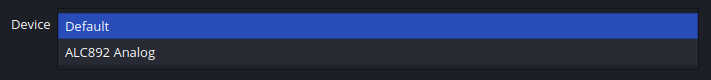
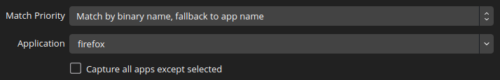

# Audio device and application capture for OBS Studio using PipeWire

This plugin adds 3 sources for capturing audio outputs, inputs and applications using [PipeWire](https://pipewire.org)



## Usage
### Requirements
- OBS Studio 28.0 or later
- WirePlumber
- PipeWire 0.3.62 or later ([#17](https://github.com/dimtpap/obs-pipewire-audio-capture/issues/17), [PipeWire#2874](https://gitlab.freedesktop.org/pipewire/pipewire/-/issues/2874))

For the plugin to be able to capture applications, PipeWire should be set up to handle audio on your system.
For most applications, the `pipewire-pulse` compatibility layer should be enough, but there are also
`pipewire-jack` and `pipewire-alsa`. If applications aren't showing up in the plugin, your system may be
missing one of those components.

### Installation
<details><summary>Flatpak</summary>

If OBS Studio is installed as a Flatpak, install the plugin from [Flathub](https://flathub.org/en/apps/com.obsproject.Studio.Plugin.PipeWireAudioCapture).
Use your software center or the following command
```sh
flatpak install flathub com.obsproject.Studio.Plugin.PipeWireAudioCapture
```

If the sources show no devices or apps, run `flatpak override --filesystem=xdg-run/pipewire-0 com.obsproject.Studio` and restart OBS Studio.
</details>

<details><summary>Others</summary>
Follow the appropriate instructions for the version of OBS Studio you use
<details><summary>Version 33 and newer</summary>

1. Get the `linux-pipewire-audio-(version)-33.tar.gz` archive from the [latest release](https://github.com/dimtpap/obs-pipewire-audio-capture/releases/latest)
2. Extract it in `~/.local/share/obs-studio/plugins` (create the folders if they don't exist)

Your files should look like this
```
.../obs-studio/plugins
├── linux-pipewire-audio
│   ├── linux-pipewire-audio.so
│   └── data
│       └── locale
│           ...
```
</details>

<details><summary>Version 28 to 32</summary>

1. Get the `linux-pipewire-audio-(version).tar.gz` archive from the [latest release](https://github.com/dimtpap/obs-pipewire-audio-capture/releases/latest)
2. In OBS Studio, go to **File**, then click **Show Settings Folder**
3. In the folder that opens, create a folder called `plugins` if it doesn't already exist
4. Extract the archive you downloaded in the `plugins` folder
5. Restart OBS Studio

Your files should look like this
```
.../obs-studio/plugins
├── linux-pipewire-audio
│   ├── bin
│   │   └── 64bit
│   │       └── linux-pipewire-audio.so
│   └── data
│       └── locale
│           ...
```
</details>
</details>

### Building (for development)
Ensure you have CMake, PipeWire and OBS Studio/libobs development packages.

> [!IMPORTANT]
> If building for OBS versions older than 33, pass `-DLEGACY=ON` when configuring CMake.

Then in the project's root, run
```sh
cmake -B build -DCMAKE_INSTALL_PREFIX="/usr" -DCMAKE_BUILD_TYPE=RelWithDebInfo #-DLEGACY=ON
cmake --build build
# To install it system-wide:
cmake --install build
```
## Inclusion in upstream OBS Studio
This plugin is currently in the process of being worked on to merge into upstream OBS Studio. See https://github.com/obsproject/obs-studio/pull/6207
